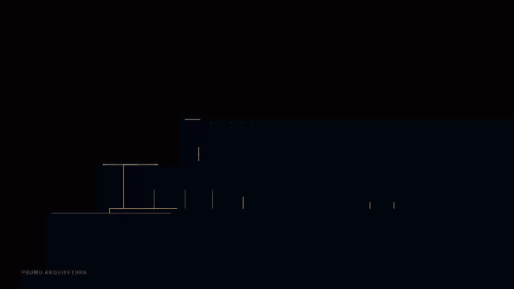
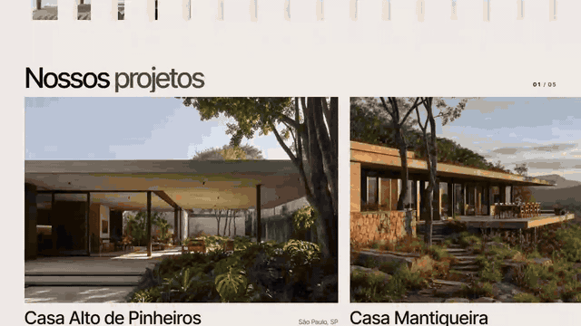
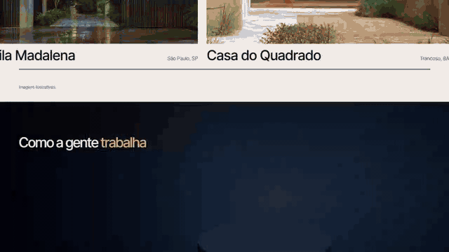
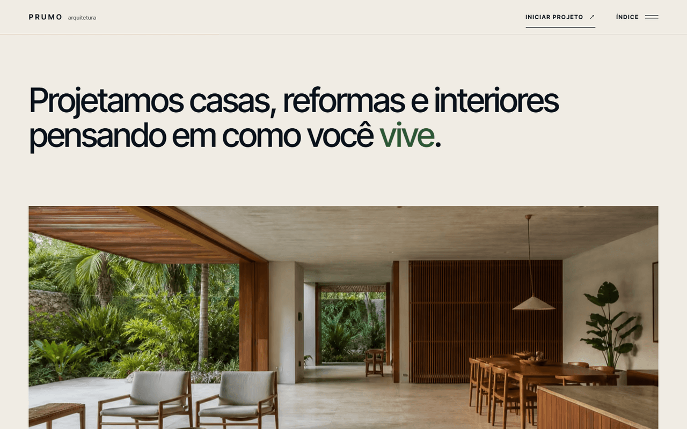
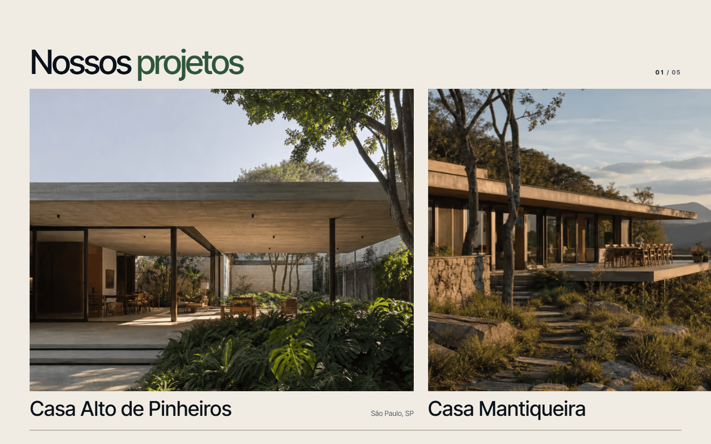
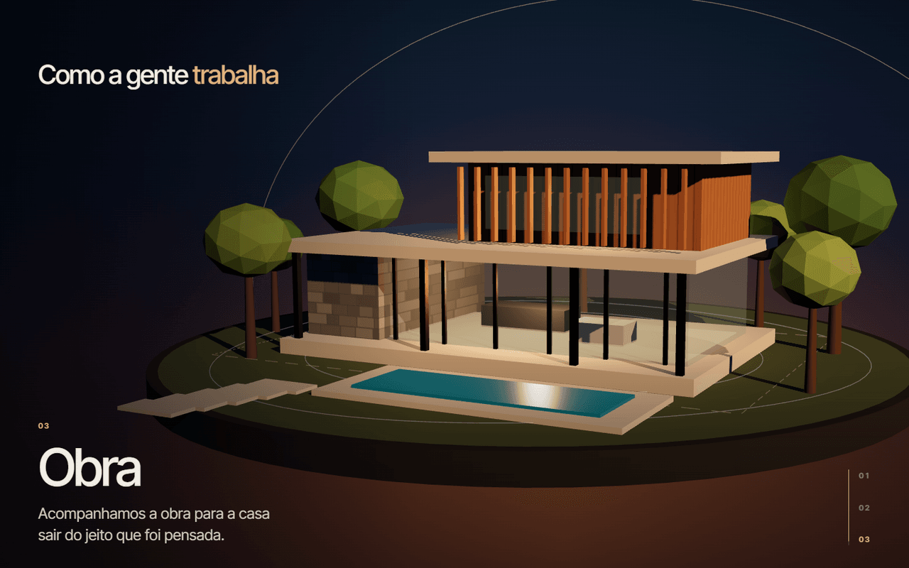
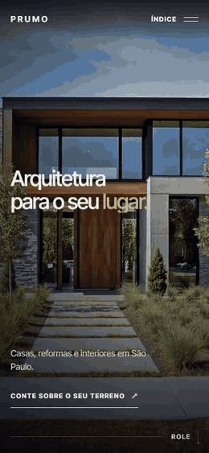
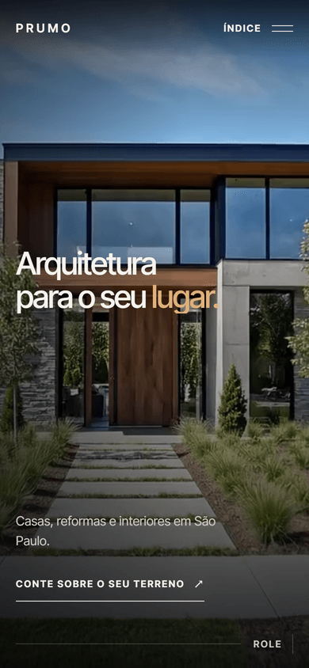
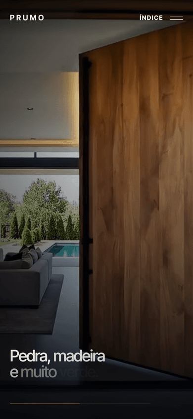

# Prumo Arquitetura

[](https://github.com/NicolasPortie/prumo-arquitetura/actions/workflows/ci.yml)


Site de um escritório de arquitetura residencial de São Paulo. A página começa com uma abertura animada, segue com um vídeo que avança conforme o visitante rola, mostra uma maquete 3D que se monta em três etapas e termina numa lista de projetos, cada um com a sua página.

Em produção: [prumo.nicolasportie.com](https://prumo.nicolasportie.com)



## O que tem no site

**Abertura e vídeo.** A fachada da casa é desenhada em traço e dois painéis se abrem como portas de correr. Depois disso o vídeo anda junto com a rolagem, com cinco frases sobre as imagens.

**Projetos.** A lista corre na horizontal. Ao abrir um projeto, a foto do cartão cresce até virar a capa da página, que tem galeria e um link para o próximo projeto.



**Método.** A maquete 3D mostra o terreno, os volumes e a estrutura enquanto o texto passa pelas três etapas: Conversa, Projeto e Obra.



**Contato.** O formulário valida cada campo e abre o app de e-mail com a mensagem pronta. Se nenhum app abrir, o visitante pode copiar a mensagem pronta ou só o e-mail do escritório.

Todas as imagens do site são ilustrativas.

## Acessibilidade e desempenho

- Quem ativa `prefers-reduced-motion` recebe a página sem animação de rolagem, sem vídeo controlado pela rolagem e sem o efeito em WebGL.
- Com economia de dados ou conexão lenta, o vídeo não é baixado e a imagem de capa fica no lugar.
- O foco fica sempre visível, o menu e os dialogs funcionam pelo teclado e o foco é devolvido ao fechá-los.
- As imagens são servidas em AVIF e WebP, em três larguras, e o Three.js só é carregado quando a seção do método está perto de aparecer.

## Telas

| Escritório | Projetos |
| --- | --- |
|  |  |

| Método | Contato |
| --- | --- |
|  |  |

No celular:

| Navegação | Início | Projetos |
| :---: | :---: | :---: |
|  |  |  |

## Tecnologias

- React 19, TypeScript e Vite
- GSAP (ScrollTrigger, SplitText, Flip e DrawSVG) e Lenis para a rolagem suave
- Three.js, importando só as classes que o site usa
- Radix Dialog para as páginas de projeto
- CSS puro, com cores definidas em OKLCH, e a fonte Inter Tight
- sharp para tratar as imagens e ffmpeg para o vídeo
- Cloudflare Pages para hospedagem

## Estrutura

```text
src/
  sections/    seções da página: abertura, escritório, projetos, método, contato e rodapé
  components/  navegação, imagem responsiva, cursor, camada WebGL e abertura
  hooks/       vídeo na rolagem, movimento reduzido e animações de entrada
  lib/         configuração do GSAP, rolagem suave, Three.js e a maquete 3D
  data/        textos, capítulos do vídeo e lista de imagens geradas
  styles/      variáveis de design e um arquivo de estilo por seção
static/        arquivos servidos como estão: imagens, vídeo, _headers, robots e sitemap
media-src/     imagens originais e vídeo de origem
scripts/       script que gera as imagens
docs/          GIFs e capturas de tela deste README
```

## Como rodar

É preciso ter Node.js 22 ou superior.

```bash
git clone https://github.com/NicolasPortie/prumo-arquitetura.git
cd prumo-arquitetura
npm install
npm run dev
```

O site abre em `http://localhost:5173`. Em desenvolvimento, `?slowmo=0.2` no endereço deixa as animações do GSAP mais lentas, o que ajuda a revisar uma transição quadro a quadro.

| Comando | O que faz |
| --- | --- |
| `npm run dev` | Inicia o servidor de desenvolvimento |
| `npm run typecheck` | Verifica os tipos |
| `npm run build` | Verifica os tipos e gera a versão de produção em `dist/` |
| `npm run preview` | Serve a versão de produção localmente |
| `npm run media` | Gera as imagens otimizadas |

O nome, a cidade e o e-mail do escritório ficam em `src/data/studio.ts` e nas meta tags do `index.html`.

## Imagens e vídeo

Os arquivos de `media-src/` são só a origem e não vão para o site. O comando `npm run media` lê esses PNGs e grava em `static/media/`:

- cada imagem em AVIF e WebP, nas larguras de 640, 1100 e 1600 px;
- um arquivo com o tamanho e a cor média de cada imagem, para a página reservar o espaço antes de carregar;
- a imagem usada na pré-visualização de links (`og-image.jpg`).

Para trocar uma foto, substitua o PNG em `media-src/` mantendo o nome e rode o comando de novo.

O vídeo foi exportado com `ffmpeg`, com um quadro-chave a cada 6 quadros. Sem isso a rolagem não responde bem ao avançar e voltar o vídeo:

```bash
ffmpeg -i media-src/entre-planos-film.mp4 -an -c:v libx264 -preset slow -crf 28 -g 6 -keyint_min 6 -sc_threshold 0 -pix_fmt yuv420p -movflags +faststart static/media/entre-planos-film.mp4
```

## Publicação

O site é estático e é publicado no Cloudflare Pages a cada push na `main`, com esta configuração:

| Campo | Valor |
| --- | --- |
| Framework preset | React (Vite) |
| Build command | `npm run build` |
| Build output directory | `dist` |
| Production branch | `main` |

Os cabeçalhos de cache e de segurança estão em `static/_headers`.

## Contribuição

Os commits seguem o padrão [Conventional Commits](https://www.conventionalcommits.org/pt-br/), por exemplo `feat(hero): ajusta a abertura`. O trabalho vai direto para a `main`, e o CI roda a verificação de tipos e o build a cada push.

## Licença

Todos os direitos reservados. Veja o arquivo [LICENSE](LICENSE).
